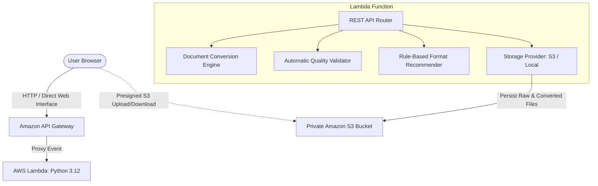

# Rapid Document Conversion

A full-stack, serverless document transformation engine built with AWS SAM, AWS Lambda (Python 3.12), Amazon S3, and Amazon API Gateway.

Featuring two core innovations:
1. **Automatic Document Conversion Quality Validation** with cryptographic magic-byte verification, format readability audits, text preservation analysis, and diagnostic explanations.
2. **Intelligent Output Format Recommendation** with a transparent, rule-based engine that recommends formats based on user goals, explains the recommendation, and allows free selection of alternative formats.

100% self-contained open-source Python processing with **zero external AI service dependencies**.

---

## Architecture Overview



### Technology Stack
- **Backend Runtime:** Python 3.12 on AWS Lambda (x86_64 architecture).
- **Infrastructure as Code:** AWS Serverless Application Model (AWS SAM) with CloudFormation.
- **Object Storage:** Private Amazon S3 bucket with server-side encryption (SSE-S3: AES256) and an automated 2-day lifecycle expiration policy.
- **API Management:** Amazon API Gateway REST API with CORS headers and binary media support.
- **Document Processing:** Pure-Python and serverless-optimized open-source libraries:
  - `pypdf`: Text layer extraction, PDF structure parsing, and page counting.
  - `reportlab`: Paginated PDF generation and typographic flowables.
  - `python-docx`: Microsoft Word (.docx) document parsing and generation.
  - `Pillow`: Image processing and cross-format transcoding (PNG, JPG, WEBP, BMP).
  - `markdown`: Markdown to semantic HTML5 compilation.
- **AI Dependencies:** Completely removed. Format recommendations and quality audits operate using transparent, deterministic algorithms with zero AI API charges.
- **Frontend:** Modern HTML5, CSS3 (glassmorphism, vibrant dark aesthetic), and Vanilla JavaScript with drag-and-drop uploads, live conversion progress, format recommendation chips, and validation audit cards.

---

## Supported Conversion Matrix

| Input Format | Supported Output Formats | Processing Method |
|---|---|---|
| **Plain Text (`.txt`)** | `PDF`, `DOCX`, `HTML`, `MD` | ReportLab, python-docx, HTML wrapping |
| **Markdown (`.md`)** | `PDF`, `DOCX`, `HTML`, `TXT` | Python Markdown compiler, ReportLab, docx |
| **Word Document (`.docx`)** | `PDF`, `MD`, `HTML`, `TXT` | python-docx XML traversal, ReportLab |
| **Adobe PDF (`.pdf`)** | `TXT`, `MD` | pypdf digital text layer extraction |
| **HTML (`.html`)** | `PDF`, `MD`, `TXT` | ReportLab text flowable generation |
| **Images (`.png`, `.jpg`, `.webp`, `.bmp`)** | `PNG`, `JPG`, `WEBP`, `BMP`, `PDF` | Pillow transcoding & ReportLab encapsulation |

*Unsupported conversions (e.g., PDF to DOCX without OCR) return a clear, structured `400 Bad Request` error instead of pretending to succeed.*

---

## Innovation Highlights

### 1. Automatic Document Conversion Quality Validation
Every converted file is immediately verified before delivery:
- **Output File Existence & Non-Empty Size:** Confirms bytes exist and size is > 0.
- **Magic Bytes & Header Signatures:** Cryptographically inspects file headers (`%PDF` for PDF, `PK\x03\x04` for DOCX, `\x89PNG` for PNG, `\xff\xd8\xff` for JPG, `RIFF...WEBP` for WebP, `BM` for BMP, valid UTF-8 for text).
- **Format Readability:** Re-parses output using the target format parser (e.g. `pypdf.PdfReader` counting pages, `docx.Document` inspecting paragraphs, `PIL.Image.open` testing dimensions).
- **Text Preservation & Token Overlap:** Compares extracted word tokens between source and output to measure content retention.
- **Size Sanity:** Validates output size relative to input to flag abnormal expansion or compression loss.
- **Results & Issue Explanations:** Emits an overall verdict (`PASS`, `WARNING`, or `FAIL`) alongside a detailed breakdown of each check. When any check produces a warning or failure, an explicit **Detected Issues & Guidance** section explains the problem and suggests actionable fixes.

### 2. Intelligent Output Format Recommendation
When a user uploads a file, the rule-based recommender evaluates the input format alongside the user's objective:
- **Share / Print:** Recommends **PDF** to preserve typography, pagination, and layout consistency across devices.
- **Easy Editing:** Recommends **DOCX** (or Markdown) for seamless modification in standard word processors.
- **Web Publishing:** Recommends **HTML** (or WebP for images) for web browser compatibility.
- **Plain Text:** Recommends **TXT** for lightweight search indexing, LLM prompts, or parsing.
- **Archival:** Recommends standardized **PDF** for long-term document retention.
- **Explanation & Choice:** Clearly explains why the recommended format fits the user's goal, while allowing the user to select any other supported format from clickable format chips.

---

## Local Development & Testing

### Prerequisites
- Python 3.12+ (run `py` or `python`)
- AWS SAM CLI (version 1.160+)

### 1. Install Dependencies
```bash
py -m pip install -r conversion_app/requirements.txt
py -m pip install -r tests/requirements.txt
```

### 2. Run Automated Unit Tests
```bash
py -m pytest tests/unit -v
```

All 27 test cases test:
- Conversion across TXT, MD, DOCX, PDF, and Image formats
- Magic byte validation and corrupted signature detection
- Quality validation issues reporting and recommendation guidance
- Rule-based format recommendations by goal
- Storage path traversal prevention
- API Gateway Lambda handler routing

### 3. Validate SAM Template
```bash
sam validate
```

### 4. Run the Web Application Locally
Without Docker or AWS credentials:
```bash
py local_server.py 8000
```
Open your browser to: **`http://localhost:8000/`**

---

## REST API Specification

| Method | Endpoint | Description |
|---|---|---|
| `GET` | `/` | Serves the web interface HTML application |
| `GET` | `/health` | Health check and active storage backend |
| `GET` | `/formats` | Supported input formats, goals, and conversion matrix |
| `POST` | `/recommend` | Rule-based format recommendation based on source format & goal |
| `POST` | `/upload-url` | Generate S3 presigned upload URL for large files |
| `POST` | `/convert` | Execute conversion, run validation, and save results |
| `GET` | `/jobs/{id}` | Retrieve job metadata, status, and validation report |
| `GET` | `/download?key={key}` | Download converted file by storage key |

### Example Conversion Payload
```json
POST /convert
Content-Type: application/json

{
  "filename": "annual_report.txt",
  "source_format": "txt",
  "target_format": "pdf",
  "content_base64": "U2FtcGxlIERvY3VtZW50IENvbnRlbnQ=",
  "goal": "share_print"
}
```

---

## Security & Storage Best Practices
- **Zero AI spend:** No billable AI API dependencies.
- **Private S3 Storage:** Public access blocked (`BlockPublicAcls: true`, `IgnorePublicAcls: true`).
- **Data Retention Policy:** Automatic 2-day expiration lifecycle rule for uploaded and converted files.
- **Path Traversal Protection:** Object keys use random UUIDs and filenames are sanitized.
- **File Size Limits:** Configurable max size (default: 10MB) enforced at the handler level.
